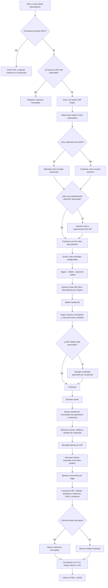

# Flujo de OWASP ZAP DAST

Este diagrama explica la fase DAST ejecutada después del descubrimiento web,
puertos, servicios y versiones. ZAP analiza la aplicación desde el exterior;
no revisa su código fuente.

## Qué significa cada recorrido

- **Spider tradicional:** encuentra páginas enlazadas, formularios y rutas HTML.
- **AJAX Spider:** utiliza navegación compatible con JavaScript para descubrir
  contenido dinámico y aplicaciones SPA.
- **Escaneo activo:** modifica solicitudes de forma controlada para buscar señales
  de inyección, XSS, traversal, cookies inseguras, divulgación de información y
  otras reglas disponibles en ZAP.
- **Correlación:** compara las alertas con los resultados de otros motores. Una
  coincidencia aumenta la prioridad de revisión, pero no confirma por sí sola una
  vulnerabilidad.

## Límites implementados

- Requiere `allow_dast: true` en el archivo de alcance.
- El AJAX Spider requiere además `allow_ajax_spider: true`.
- Usa como máximo cinco hosts; con `-sub` recibe únicamente el subdominio exacto.
- Importa como máximo 200 semillas de Katana por host.
- El spider tradicional limita cada recorrido a 200 elementos hijos.
- El plazo predeterminado es de 10 minutos y puede configurarse con
  `dast_max_minutes` entre 1 y 60 minutos.
- Las rutas de `exclude_paths` no se entregan al spider ni al escaneo activo.
- Las cabeceras de autenticación se aplican solamente al origen objetivo y se
  eliminan de ZAP al terminar.
- Si vence el plazo o falla la API de ZAP, el resultado se declara incompleto.

## Interpretación de resultados

Una alerta de ZAP es evidencia para revisión, no una vulnerabilidad confirmada.
El informe la clasifica inicialmente como:

- `POTENTIAL`: señal con evidencia o confianza limitada.
- `PROBABLE`: confianza alta y evidencia concreta.
- `FALSE POSITIVE`: ZAP la marcó como falso positivo y el escáner la descarta.

La confirmación final requiere reproducir la condición de manera controlada y
verificar el comportamiento del servidor sin extraer datos ni explotar el sistema.
