# Flujo completo de `uncp_offsec scan -sub`

El diagrama contiene el recorrido completo de la suite para un subdominio exacto.
ZAP DAST es una etapa del flujo, no el flujo completo.

```mermaid
flowchart TD
    A["COMANDO<br/><code>uncp_offsec scan -sub subdominio.ejemplo.edu.pe</code>"] --> B["PREPARACIÓN AUTOMÁTICA<br/>exact-host · perfil active-validation · sin correo<br/>HTML de salida · caché CVE · wordlist aprobada"]

    B --> C{"ALCANCE OBLIGATORIO<br/>¿El host está en domains y allow_active=true?"}
    C -- "No" --> STOP["DETENER ANTES DE PROBAR<br/>No se envían pruebas fuera del alcance"]
    C -- "Sí" --> D["APLICAR PERMISOS Y LÍMITES<br/>SQLi · Nmap vuln · DAST · AJAX · acceso anónimo · rate-limit<br/>dast ≤ 60 min · máximos de objetivos/solicitudes · exclude_paths"]

    D --> E["OBJETIVO EXACTO<br/>Solo el host indicado · no Subfinder · no otros subdominios<br/>resolver IP y continuar únicamente si HTTP/HTTPS está vivo"]

    E --> F["1 · SUPERFICIE WEB<br/>HTTPX/curl: HTTP, HTTPS, estado, redirección y título<br/>WhatWeb: servidor, framework, CMS y tecnologías<br/>curl: CSP, HSTS, X-Frame, cookies y otras cabeceras<br/>DNS: A, AAAA, CNAME y TXT<br/>testssl.sh: protocolos, cifrados y certificado; fallback OpenSSL"]

    F --> G["2 · COBERTURA DE APLICACIÓN<br/>Katana: enlaces y JavaScript, hasta 200 URL semilla<br/>Anónimo: login, API, identificadores, recursos sensibles y acceso<br/>Rate-limit: prueba acotada solo si está permitida<br/>ffuf: wordlist, 5 req/s, 2 hilos, máximo 180 s<br/>SQLMap: solo URL parametrizadas o requests aprobadas; detección sin extraer datos"]

    G --> H["3 · RED Y VULNERABILIDADES CONOCIDAS<br/>Naabu: 1,000 puertos TCP principales<br/>Nmap: confirmar servicio/versión y ejecutar scripts autorizados<br/>Nuclei: plantillas fijadas y revisadas, sin autoactualización<br/>CVE: correlacionar solo versiones exactas; sin versión no se infiere CVE"]

    H --> I{"4 · ZAP DAST<br/>¿allow_dast=true y el servicio ZAP está saludable?"}
    I -- "No" --> INC["COBERTURA INCOMPLETA<br/>Registrar TOOL_INCOMPLETE y continuar el flujo"]
    I -- "Sí" --> J["PREPARAR ZAP<br/>Sesión limpia · cabeceras solo para el origen autorizado<br/>OpenAPI solo dentro del alcance · aplicar exclude_paths<br/>importar hasta 200 URL descubiertas por Katana"]

    J --> K["RECORRIDO ZAP<br/>Spider clásico: enlaces, formularios y HTML, máximo 200 hijos<br/>AJAX Spider: Firefox headless para JavaScript/SPA, si está permitido<br/>Active Scan: variaciones controladas para XSS, inyección,<br/>traversal, cookies, cabeceras y errores de configuración"]

    K --> L["NORMALIZAR ALERTAS ZAP<br/>Descartar las marcadas false positive · agrupar ocurrencias<br/>conservar URL, método, parámetro, evidencia, CWE y confianza"]

    L --> M{"5 · ¿SE ENTREGÓ CÓDIGO CON --source?"}
    M -- "SAST" --> M1["Semgrep o Bandit<br/>análisis estático"]
    M -- "SCA" --> M2["Trivy o pip-audit<br/>dependencias"]
    M -- "No" --> N
    M1 --> N
    M2 --> N
    INC --> M

    N["6 · CONSOLIDACIÓN<br/>Correlacionar cabeceras, TLS, puertos, Nmap, Nuclei,<br/>CVE, ZAP y, si existen, SAST/SCA<br/>deduplicar · severidad · estado POTENTIAL/PROBABLE<br/>calcular puntuación, cobertura, confianza y OWASP Top 10"] --> O["7 · INFORME HTML O JSON<br/>Módulos ejecutados · hallazgos únicos · evidencia<br/>ocurrencias · límites · timeouts · cobertura incompleta"]

    F -. "fallo o timeout" .-> INC
    G -. "fallo o timeout" .-> INC
    H -. "fallo o timeout" .-> INC
    K -. "plazo agotado" .-> INC

    P["LÍMITES PERMANENTES<br/>Solo activos autorizados · sin obtener acceso ni shells<br/>sin persistencia ni extracción de datos<br/>sin evasión de WAF ni borrado de rastros"] --- O

    classDef decision fill:#fff3cd,stroke:#9a6700,color:#24292f;
    classDef stop fill:#ffebe9,stroke:#cf222e,color:#24292f;
    classDef stage fill:#ddf4ff,stroke:#0969da,color:#24292f;
    classDef result fill:#dafbe1,stroke:#1a7f37,color:#24292f;
    class C,I,M decision;
    class STOP,INC stop;
    class F,G,H,J,K,L,M1,M2 stage;
    class O result;
```

El comando `-sub` no descubre correo ni amplía el objetivo a otros subdominios.
El alcance decide qué validaciones activas están autorizadas. Un resultado de
ZAP, Nuclei o Nmap es evidencia técnica para revisión; no debe presentarse como
vulnerabilidad confirmada hasta reproducir y validar su impacto de forma
controlada.
